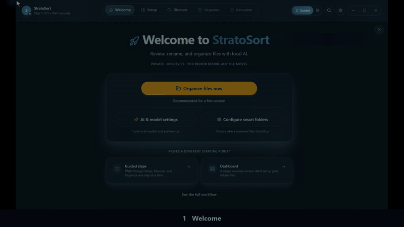

<p align="center">
  
</p>

<h1 align="center">StratoSort Stack</h1>

<p align="center">
  <strong>Organize, search and chat with your files using AI that runs on your own computer.</strong>
</p>

<p align="center">
  <a href="https://github.com/iLevyTate/StratoSortStack/releases"></a>
  <a href="https://github.com/iLevyTate/StratoSortStack/actions/workflows/ci.yml"></a>
  <a href="LICENSE"></a>
  
</p>

<p align="center">
  <a href="https://github.com/iLevyTate/StratoSortStack/releases"><strong>Download</strong></a> ·
  <a href="https://stratosort.com/docs/"><strong>Documentation</strong></a> ·
  <a href="https://stratosort.com/"><strong>Website</strong></a> ·
  <a href="CHANGELOG.md">Changelog</a>
</p>

<p align="center">
  <a href="https://stratosort.com/docs/E2E_WALKTHROUGH.html#9-videos">
    
  </a>
  <br />
  <sub>The tour at 2× speed. <a href="docs/walkthrough-assets/how-to-use.mp4">Watch the full-quality video</a>.</sub>
</p>

StratoSort reads what is inside your files (documents, spreadsheets, images, scans, audio and
video), suggests a clear name and the right folder for each one, and lets you search and ask
questions across all of them. The AI runs on your machine: there is no account, no cloud service and
no telemetry.

## What it does

- **Organizes by content.** Suggests names and folders from what a file contains, not its filename.
  You review every suggestion before anything moves, and every move can be undone.
- **Smart Folders.** Describe a folder in plain words ("invoices and receipts") and matching files
  are routed into it, including new files as they arrive.
- **Search by meaning.** Find the report about "how warming affects wildlife" even when those words
  are not in its name. Exact matches such as an invoice number still work.
- **Chat with your documents.** Ask questions and get answers built from your own files, with
  sources.
- **See how files connect.** Relate (a graph) and Atlas (a map) show related files, clusters and
  near-duplicates.
- **Reads images, scans and recordings.** Vision and OCR for photos, screenshots and scanned PDFs;
  local Whisper transcription for audio and video.
- **Works with other AI tools.** An opt-in local [MCP server](docs/MCP_SERVER.md) lets Claude
  Desktop, Cursor or Zed search your files without uploading them.
- **Optional cloud AI.** Bring your own Anthropic or OpenAI-compatible key for some tasks, with a
  monthly spend cap. Search and embeddings always stay local. See
  [Cloud AI Providers](docs/AI_PROVIDERS.md).

## Install

1. **Download** the installer for your system from
   [GitHub Releases](https://github.com/iLevyTate/StratoSortStack/releases).
2. **Launch it** and choose a model profile. StratoSort downloads its AI models once: about 7 GB for
   Base, or about 10 GB for Better Quality.
3. **Add a folder** and review the suggestions.

No terminal, Python, Docker or API keys. Windows installers are Authenticode-signed and macOS builds
are signed and notarized by Kennedy Applied Sciences, Inc. The
[Install Guide](docs/INSTALL_GUIDE.md) covers first-launch prompts and how to check the download's
checksum.

| System      | Supported                                                       | Installers            |
| :---------- | :-------------------------------------------------------------- | :-------------------- |
| **Windows** | Windows 10 (22H2) or 11, x64 or arm64                           | Installer or portable |
| **macOS**   | macOS 13 (Ventura) or later, Apple Silicon or Intel             | DMG or ZIP            |
| **Linux**   | Ubuntu 22.04 or later and derivatives, x64 or arm64             | AppImage or .deb      |
| **Memory**  | 8 GB RAM minimum; 16 GB RAM and an 8 GB GPU for Better Quality  |                       |
| **GPU**     | Optional. NVIDIA CUDA, Apple Metal or Vulkan; falls back to CPU |                       |

Need it on a machine with no internet access? See
[Offline and air-gapped install](docs/INSTALL_GUIDE.md#offline-and-air-gapped-install).

## Privacy

- Analysis, search and chat run on your computer with AI models stored locally.
- No account, no analytics, no crash reporting to anyone.
- After the one-time model download, the only automatic connection is the update check, which you
  can turn off in **Settings → Application → Background update checks**. Every connection the app
  can make is listed in [Network Transparency](docs/NETWORK_TRANSPARENCY.md).
- The search index, including text extracted from your files, stays in the app's data folder on your
  machine.

See [SECURITY.md](SECURITY.md) to report a vulnerability.

## Supported files

Documents and office files, text and code, images, audio, video, archives, and 3D/design files: over
100 file types in all.

<details>
<summary>Full list</summary>

- **Documents and office:** `.pdf`, `.doc`, `.docx`, `.xlsx`, `.pptx`, `.odt`, `.ods`, `.odp`,
  `.epub`, `.eml`, `.msg`, `.kml`, `.kmz`, `.ipynb`
- **Text, code and data:** `.txt`, `.md`, `.rtf`, `.tex`, `.csv`, `.json`, `.xml`, `.yml`, `.yaml`,
  `.html`, `.htm`, `.css`, `.scss`, `.sass`, `.less`, `.js`, `.ts`, `.jsx`, `.tsx`, `.sql`, `.py`,
  `.java`, `.c`, `.cpp`, `.h`, `.rb`, `.go`, `.rs`, `.php`, `.sh`, `.bat`, `.ps1`, `.ini`, `.conf`,
  `.log`, `.scad`. Files over the text size limit (50 MB by default) are analyzed from their first
  part.
- **Images:** `.jpg`, `.jpeg`, `.png`, `.gif`, `.bmp`, `.webp`, `.svg`, `.tiff`, `.tif`, `.ico`;
  `.heic` and `.heif` when the bundled FFmpeg can decode them, otherwise by filename and date
- **Audio** (transcribed locally): `.mp3`, `.wav`, `.flac`, `.aac`, `.ogg`, `.oga`, `.m4a`, `.m4b`,
  `.opus`, `.wma`, `.aiff`, `.aif`
- **Video** (audio transcribed; keyframe descriptions optional): `.mp4`, `.mov`, `.mkv`, `.webm`,
  `.avi`, `.flv`, `.m4v`, `.wmv`, `.3gp`, `.mts`, `.m2ts`
- **Archives:** `.zip`, `.tar`, `.tgz` and `.gz` are listed by content; `.rar`, `.7z` and `.bz2` are
  organized by name only
- **3D and design:** `.stl`, `.obj`, `.3mf`, `.gcode`, `.scad`, `.ai`, `.eps` (metadata and text);
  `.psd` by filename and date only

Legacy `.xls` and `.ppt` files are organized by filename and date only; save them as `.xlsx` or
`.pptx` to have their contents analyzed.

</details>

## Documentation

| For users                                               | For developers                                      |
| :------------------------------------------------------ | :-------------------------------------------------- |
| [Install Guide](docs/INSTALL_GUIDE.md)                  | [Getting Started](docs/GETTING_STARTED.md)          |
| [User Guide](docs/USER_GUIDE.md)                        | [Onboarding: clone to first PR](docs/ONBOARDING.md) |
| [Screen-by-Screen Walkthrough](docs/E2E_WALKTHROUGH.md) | [Architecture](docs/ARCHITECTURE.md)                |
| [Network Transparency](docs/NETWORK_TRANSPARENCY.md)    | [Configuration Reference](docs/CONFIG.md)           |
| [Cloud AI Providers](docs/AI_PROVIDERS.md)              | [Testing](docs/TESTING.md)                          |
| [MCP Server](docs/MCP_SERVER.md)                        | [Release Guide](docs/RELEASING.md)                  |
| [Commercial Licensing](docs/COMMERCIAL.md)              | [All developer docs](docs/README.md)                |

The same docs are published at [stratosort.com/docs](https://stratosort.com/docs/).

## Build from source

Requires Node.js 20.19 or later (see `.nvmrc`).

```bash
git clone https://github.com/iLevyTate/StratoSortStack.git
cd StratoSortStack
npm ci
npm run dev
```

The app opens with the same first-launch model setup as the installer. Electron 45, React 19,
node-llama-cpp for local inference and Orama for search; see [Architecture](docs/ARCHITECTURE.md)
and [Getting Started](docs/GETTING_STARTED.md) for the rest.

## Contributing and support

- **Bugs:**
  [open a bug report](https://github.com/iLevyTate/StratoSortStack/issues/new?template=bug_report.md)
- **Ideas:** [open an issue](https://github.com/iLevyTate/StratoSortStack/issues/new)
- **Code:** read [CONTRIBUTING.md](CONTRIBUTING.md), then open a pull request. Run `npm test` before
  you do.
- **Testing a release:** the [Tester Guide](docs/BETA_TESTER_GUIDE.md) explains what to check and
  how to report it.

## License

Free for personal and other noncommercial use under the
[PolyForm Noncommercial License 1.0.0](LICENSE). Commercial use needs a paid license from Kennedy
Applied Sciences, Inc.; see [Commercial Licensing](docs/COMMERCIAL.md). Third-party components keep
their own licenses ([Third-Party Notices](docs/THIRD_PARTY_NOTICES.md)).

StratoSort Stack succeeds the original [StratoSort](https://github.com/iLevyTate/elstratosort) and
was inspired by [llama-fs](https://github.com/iyaja/llama-fs),
[Local-File-Organizer](https://github.com/QiuYannnn/Local-File-Organizer) and
[ai-file-sorter](https://github.com/hyperfield/ai-file-sorter).

<p align="center"><sub>© 2026 Kennedy Applied Sciences, Inc.</sub></p>
