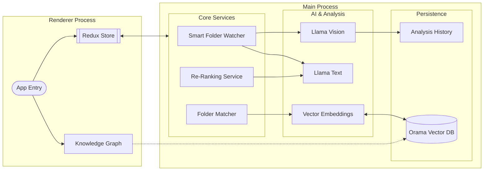

# StratoSort Stack Architecture

> For the strategic principles behind these architectural choices (deep modules, anti-pass-through,
> generality, hard constraints), see [`PHILOSOPHY.md`](PHILOSOPHY.md).

## High-Level Information Flow

This diagram illustrates the flow of data through the application, highlighting the separation
between the Renderer (UI), the IPC Bridge, and the specialized in-process services.





## Key Architectural Components

### 1. Smart Folder Watcher

The watcher is the proactive heart of the system. Unlike a standard file watcher, it:

- Monitors configured paths for new/modified files.
- **Debounces** events to ensure files are fully written.
- Dispatches files to **LlamaService** (Text or Vision) for analysis.
- Automatically generates embeddings and updates **Orama Vector DB**.
- Triggers notifications and auto-organization based on confidence thresholds.

### 2. Semantic Search and Re-Ranking

Search is a two-stage pipeline that spans two services:

1.  **Retrieval** (`SearchService` / `OramaVectorService`): Fetches top candidates using hybrid
    search (vector similarity + BM25 full-text).
2.  **Re-Ranking** (`ReRankerService`, optional): Receives the pre-ranked candidates and uses a
    lightweight LLM to score each one's relevance to the query (0-10 scale, normalized to 0-1),
    re-ordering them to bubble up the best matches. Off by default: Chat's Deep mode turns it on;
    the Search tab and the MCP `search_documents` tool do not.

`ReRankerService` itself does not perform retrieval -- it operates solely on candidates passed to
it.

### 3. Unified Folder Matching

This service acts as the bridge between raw AI analysis and your filesystem. It:

- Manages the **Orama** connection.
- Generates embeddings for file content.
- Matches new files against existing folder "clusters" to suggest destinations.
- Handles deduplication of requests to prevent overloading the local AI.

### 4. Knowledge Graph Visualization



The Knowledge Graph is a visual representation of your vector database.

- **Nodes**: Represent files, clusters, or search queries.
- **Edges**: Represent semantic similarity (distance in vector space).
- **Implementation**: Built with `React Flow` in the renderer, fetching live node data from the main
  process via IPC.

### 5. Service Container

The DI container that owns the lifecycle of every backend service:

- **Registration**: Factory-based with three lifetimes -- `singleton`, `transient`, and `instance`
  (pre-created objects registered as singletons).
- **Resolution**: Async resolution with in-flight deduplication (prevents duplicate initialization
  of the same singleton). Circular dependency detection works for both synchronous `resolve()` (via
  shared resolution stack) and `resolveAsync()` (via `AsyncLocalStorage` per-chain tracking).
- **Shutdown ordering**: Deterministic teardown defined in `SHUTDOWN_ORDER` -- watchers first, then
  AI services (VisionService, LlamaService, OramaVector), then settings last.

### 6. Startup Manager

Orchestrates the boot sequence with progress reporting to the splash screen:

- **Phases** (progress reported to splash): Starting (0%) -> Preflight checks (10%) -> Migration
  (12%) -> Services -> Models -> App Services -> Ready (100%). See `reportProgress(...)` calls in
  `StartupManagerCore.js` for the authoritative sequence.
- **Timeout**: the coordinated startup timer in `simple-main.js` aborts after 45s
  (`SERVICE_STARTUP` + 15s) via `AbortController`; every phase checks `signal.aborted` before
  proceeding. `StartupManagerCore`'s own 60s `startupTimeout` is a backstop that never fires first.
- **Health monitoring**: After startup completes, a 2-minute interval polls service health.

### 7. IPC Handlers

Handler modules registered by `registerAllIpc()` in `src/main/ipc/index.js`, organized by domain:

- **Top-level**: `analysis`, `analysisHistory`, `chat`, `files`, `knowledge`, `llama`, `whisper`,
  `organize`, `semantic`, `settings`, `smartFolders`, `suggestions`, `system`, `undoRedo`,
  `vectordb`, `window`, `downloads`, `mcp`, `aiProvider`, `license`.
- **Files subdirectory**: `fileOperationHandlers`, `fileSelectionHandlers`, `folderHandlers`,
  `shellHandlers`, plus helpers such as `taggingHandlers`, `batchOrganizeHandler`,
  `destinationPolicy` (where a renderer-requested write may land), `batchLockManager`,
  `batchProgressReporter`, `batchRollback`, `batchValidator`, and `embeddingSync`.
- **`IpcServiceContext`**: Groups service dependencies into a single context object, replacing
  28-parameter function signatures.
- **`ipcWrappers`**: Composable middleware (`withErrorLogging`, `withValidation`,
  `withServiceCheck`) and a unified `createHandler` factory.

### 8. AI and Analysis

#### LlamaService

In-process GGUF inference via node-llama-cpp. Three model types: text (Llama 3.2 3B default, or
Qwen2.5-7B for better quality), vision (config/coordination only, delegates to VisionService),
embedding (all-MiniLM-L6-v2 or nomic-embed 768d). GPU auto-detection (CUDA -> Vulkan -> Metal ->
CPU), lazy loading via ModelMemoryManager (LRU eviction; budget is the larger of 70% of free RAM
capped at 16 GB and 80% of VRAM, with the VRAM share on Apple Silicon capped at total RAM minus 4
GB).

#### VisionService

Out of process: a bundled `llama-server` child reached over local HTTP, registered with
ModelMemoryManager as the `vision-runtime` consumer and torn down when memory is needed elsewhere.
The per-image timeout is the 300s `AI_ANALYSIS_LONG`, hard-coded in `analysis/imageAnalysis.js`
(`AppConfig.ai.imageAnalysis.timeout`) and applied twice over the same budget — once as the vision
HTTP request timeout and once as the abortable wrapper around it. There is no narrower inner bound
and no setting that shortens it: `VISION_REQUEST` (90s) is only VisionService's fallback for callers
that omit `timeoutMs`, which this path never does, and `CONFIG_SCHEMA`
(`shared/config/configSchema.js`) deliberately declares no per-image timeout key — it used to carry
a dead one that nothing read. `VISION_STARTUP` allows 120s for the first load (300s on CPU), with
health check polling.

#### Document Extractors

PDF (unpdf + OCR fallback), DOC (word-extractor; RTF or plain text saved as .doc is read as such),
DOCX (mammoth), XLSX (xlsx-populate), PPTX and ODT/ODS/ODP (officeparser, with ZIP tag-stripping
fallbacks), EPUB (OPF spine order), EML (postal-mime), MSG (@kenjiuno/msgreader, compressed-RTF
bodies via @kenjiuno/decompressrtf), KML/KMZ, Jupyter notebooks, CSV, RTF (tokenizer in
`analysis/extractors/rtfText.js`, shared with the text extraction worker), plain text. 3D and design
files (`analysis/extractors/cadDesignExtractors.js`) are read as metadata text; tar/tgz/gz archives
are listed (`archiveListing.js`); SVG text is read before rasterizing; HEIC/HEIF is decoded through
the bundled FFmpeg when possible (`heicDecode.js`); Windows icons are decoded with decode-ico. OCR:
Tesseract.js (bundled `eng` traineddata only) on unpdf-rendered pages, max 3 PDF pages / 10 office
images, 150 DPI, 30 MB input cap. File-size limits (configurable in Advanced mode under Settings →
Performance → Processing limits; the panel is hidden in Simple mode unless a settings search matches
it): 100 MB images, 200 MB documents, 50 MB text; text files over the 50 MB limit are analyzed from
their first 50 MB. The 500k-character cap on extracted text is a hard-coded constant
(`MAX_TEXT_LENGTH` in `analysis/documentExtractors.js`), not a setting.

#### Concurrency & Resilience

- **ModelAccessCoordinator**: per-type load queues (mutex), inference queue (1-4 concurrent, 100
  max)
- **LlamaResilience**: per-model-type circuit breaker (5-failure threshold, 300 s recovery; an open
  breaker shows in `getHealthStatus().openCircuits` and in Settings → AI Configuration), 3 retries
  with exponential backoff, GPU->CPU fallback
- **ModelMemoryManager**: LRU eviction, OOM prevention, estimates per model type (refined from the
  model file size at load). Out-of-process consumers register as external entries: the Whisper
  context (`audio`) and the vision `llama-server` child (`vision-runtime`), which pins itself while
  a request is in flight. A vision spawn is refused (`MODEL_MEMORY_BUDGET_EXCEEDED`) when pinned
  residents leave no room for it.
- **DegradationManager**: system readiness checks, determines recovery actions

#### Model Download (`ModelDownloadManager.js`)

Resume support (`.partial` + Range headers), SHA-256 verification, disk space checks. Auto-downloads
companion files (vision projectors), model catalog in `src/shared/modelRegistry.js`.

#### Embedding Pipeline

- **ParallelEmbeddingService**: semaphore-based concurrency (CPU-adaptive, max 10), dynamic
  adjustment on error rate
- **`src/main/analysis/embeddingQueue/`**: separate stage queues for files vs folders, batch upsert
  with individual fallback

## Renderer / UI Layer

### Entry & Routing

**Entry:** `src/renderer/index.js` (React 19 + `createRoot`, prefetches docs path / redact paths /
smart folders / settings).

Phase-based routing via `PhaseRenderer.jsx` (no React Router): WELCOME -> SETUP -> DISCOVER ->
ORGANIZE -> COMPLETE

Each phase lazy-loaded with `React.lazy()` + `Suspense`, wrapped in `PhaseErrorBoundary`.

### Redux Store (7 slices)

| Slice             | Responsibility                                              |
| :---------------- | :---------------------------------------------------------- |
| `uiSlice`         | Phase management, loading flags, settings cache, modals     |
| `filesSlice`      | File selection, smart folders, organization history, naming |
| `analysisSlice`   | Analysis progress, results (max 5000), embedding state      |
| `systemSlice`     | CPU/memory metrics, service health, notifications, paths    |
| `mcpServerSlice`  | MCP server lifecycle/status (`mcp` reducer key)             |
| `aiProviderSlice` | Cloud AI provider config, per-feature routing, budget       |
| `licenseSlice`    | License status shown under Settings → License (`license`)   |

**Middleware:** `ipcMiddleware` (event queue + Zod validation), `persistenceMiddleware` (1s
debounce, quota-aware degradation).

### Knowledge Graph (`GraphTabContent.jsx` + `search/hooks/useGraphTab.js`, about 7,400 lines together)

React Flow with ELK layout, max 300 nodes.

- **4 node types:** file, folder, query, cluster
- **4 edge types:** similarity, queryMatch, smartStep, knowledge
- **Features:** Multi-hop discovery, drag-and-drop, keyboard nav, chat panel, cluster legend, guided
  tour

#### Graph UX Notes

- **Bridge files**: Cross-cluster edges include a small sample of "bridge files" picked by
  similarity to opposing cluster centroids. This is best-effort and not an exhaustive list.
- **Guide intents**: "Expand from selection" and "bridges-only" intents are supported; the
  bridges-only overlay dims non-bridge edges.
- **Filter visibility**: Active graph filters are surfaced as chips on the graph (top-left overlay)
  and can be reset from there.

### Component Groups

| Directory   | Contents                                  |
| :---------- | :---------------------------------------- |
| `discover/` | Drag-drop zone, analysis progress         |
| `organize/` | Suggestions, virtualized grids            |
| `search/`   | Graph, chat panel, autocomplete           |
| `settings/` | Model selection, embedding rebuild        |
| `setup/`    | Smart folder management (add/edit modals) |
| `ui/`       | Design system (Button, Card, Modal, etc.) |
| `icons/`    | Icon components                           |
| `layout/`   | AppShell, ActionBar                       |

Root-level components include `PhaseRenderer`, `NavigationBar`, `SettingsPanel`, `ModelSetupWizard`,
Toast system, and error boundaries.

### IPC Bridge (`src/preload/preload.js`)

Rate-limited (200 req/s), sanitized, channel-whitelisted. Default invoke timeout is 330s
(`IPC_INVOKE_TIMEOUT`), with per-channel overrides via `src/shared/ipcInvokeTimeout.js` (e.g.
downloads triage scans allow up to 900s). Retries use exponential backoff.

## Data Flow & Caching

### Analysis Caching

To respect local resources, we use a multi-tiered caching strategy:

- **`AnalysisCacheService`**: Uses LRU caching for expensive AI responses (vision/text analysis).
- **`AnalysisHistory`**: Persisted log of all past analyses to prevent re-processing unchanged
  files.
- **`globalDeduplicator`** (`LLMRequestDeduplicator`, `src/main/utils/llmOptimization.js`): Prevents
  identical requests (e.g., same image analyzed twice in quick succession) from hitting the LLM.

### In-Flight Deduplication

We maintain separate queues to manage different types of bottlenecks:

- **LLM Queue**: Limits concurrent heavy AI tasks (via `ModelAccessCoordinator`).
- **DB Queue**: Manages read/write locks for Orama.

## Service Depth Audit (2026-05-16)

A Phase 3 audit (see
[`baselines/phase-3-shallow-service-audit.md`](baselines/phase-3-shallow-service-audit.md)) reviewed
three services flagged as candidates for merging or collapsing:

- **`SettingsService` (1,205 LOC, 13 callers) — KEPT.** Custom mutex error, TTL cache, file watcher,
  atomic-write protocol, backup rotation, schema validation, corruption recovery. Genuine deep
  module.
- **`BatchAnalysisService` (1,071 LOC, 1 caller) — KEPT.** Single caller is the IPC entry point, not
  over-specialization. Internal semaphores, lazy Whisper load, per-modality routing, and progress
  orchestration earn the module boundary; inlining into `analysis.js` would replay Phase 2's bloat.
- **`AnalysisHistoryServiceCore` (1,380 LOC, 7 references) — KEPT.** Already decomposed into 8
  cohesive sibling modules in `analysisHistory/`. The Core is the deliberate coordinator (circuit
  breaker, schema validation, immutable-cache cloning, debounced flush). Further splitting would
  re-create pass-through layers.

No code changes from the audit. Outcome recorded for future contributors.

## Code Standards

For information on coding patterns, error handling, and dependency injection, refer to the other
documentation files:

- [Code Quality Standards](/CODE_QUALITY_STANDARDS.html)
- [Dependency Injection Patterns](/DI_PATTERNS.html)
- [Error Handling Guide](/ERROR_HANDLING_GUIDE.html)
