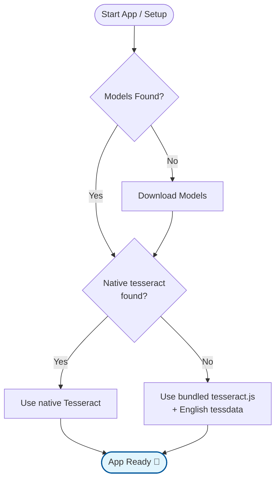

> **Note:** For a guided clone-to-first-PR walkthrough including architecture context, IPC tracing,
> and common gotchas, see [`ONBOARDING.md`](ONBOARDING.md). This doc focuses on the mechanical setup
> steps. Current product version is **5.0.0**. Last mechanical setup pass was v4.0.3 on 2026-06-11;
> Node/npm steps are unchanged.

# Getting Started with StratoSort Stack


 {:
.text-center }

This guide will walk you through setting up **StratoSort Stack** on your local machine.

## System Requirements

Before you begin, ensure your system meets the following requirements. StratoSort Stack runs a fully
local, in-process AI stack and does not rely on external servers.

### System Dependencies Chart

| Component       | Purpose                  | Requirement / Setup                                             |
| :-------------- | :----------------------- | :-------------------------------------------------------------- |
| **Node.js**     | Core Application Runtime | v20+ (see `.nvmrc` for exact version; dev needs Node installed) |
| **GGUF Models** | Local AI Inference       | Auto-downloaded on first use (`npm run setup:models`)           |
| **Orama**       | Vector Search DB         | Bundled in the app (no external install)                        |
| **Tesseract**   | Image Text Recognition   | Bundled `tesseract.js` + English tessdata; native optional      |
| **GPU**         | AI Acceleration          | Optional but recommended (4GB+ VRAM)                            |

---

## Installation

### 1. Clone the Repository

```bash
git clone https://github.com/iLevyTate/StratoSortStack.git
cd StratoSortStack
```

### 2. Install Dependencies

```bash
npm ci
```

<!-- prettier-ignore -->
**Note:** `npm install`/`npm ci` runs `postinstall`, which rebuilds native modules and runs setup scripts (best-effort). To skip, set `SKIP_APP_DEPS=1` before installing.
{: .notice--info}

### 3. Start the Application

```bash
npm run dev
```

---

## Detailed Setup Instructions

On the first launch, the application offers to download the AI models it needs. OCR needs no setup:
it uses the bundled `tesseract.js` engine.

### Platform Notes

- **All platforms:** Use the model setup wizard's **Download models** action on first launch to
  fetch the profile's models. OCR runs on `tesseract.js`; nothing is installed on your system.
- **Optional native Tesseract:** If a `tesseract` binary is on your `PATH` (or `TESSERACT_PATH`
  points to one), the app uses it instead of `tesseract.js`.
- **In-app setup:** The Settings panel lets you configure models and verify OCR status.

### Setup Workflow (No-CLI first run)

The following flowchart illustrates the automated setup process that runs on first launch:



### Startup Preflight Checks

On each launch, StratoSort Stack runs preflight checks to verify model availability, vector DB
readiness, and OCR health. If a service is slow to respond, you can raise the timeout using
`SERVICE_CHECK_TIMEOUT` (ms). Check logs if the app reports missing or unreachable dependencies.

### Tesseract OCR Setup

StratoSort Stack uses **Tesseract OCR** to read text from images. Nothing is installed on your
system. The app picks a backend in this order:

1. `TESSERACT_PATH`, if set, pointing to a native `tesseract` binary.
2. A `tesseract` binary on your `PATH`.
3. Otherwise the bundled `tesseract.js` engine (the normal case).

#### Language Data (tessdata)

- **`tesseract.js`**: Packaged builds ship the English model (`eng.traineddata`) in
  `assets/runtime/tessdata/`, staged by `npm run setup:tessdata-runtime`, so OCR works offline. In a
  dev checkout, run that script once; without it, `tesseract.js` downloads the model on first OCR.
- **Native Tesseract**: Uses that installation's tessdata directory (e.g.
  `/usr/share/tesseract-ocr/5/tessdata`, `/opt/homebrew/share/tessdata`, or
  `C:\Program Files\Tesseract-OCR\tessdata`). If language data is in a non-standard location, set
  `TESSDATA_PREFIX` to the tessdata directory.

Native Tesseract is optional. If you want it (for example, for extra languages), install it yourself
(`brew install tesseract`, `sudo apt-get install tesseract-ocr`, or the
[UB-Mannheim build](https://github.com/UB-Mannheim/tesseract/wiki) on Windows) and restart the app.

#### `tesseract.js` Behavior

- Works without a system install
- Uses English (`eng`) by default
- Can be slower on large images

Check logs for `[OCR]` messages to confirm which backend is active.

#### Adding Additional Languages

To use languages other than English:

1. **Native Tesseract** (install it first, as above):
   - Windows: Download `.traineddata` files from https://github.com/tesseract-ocr/tessdata and place
     them in `C:\Program Files\Tesseract-OCR\tessdata\`.
   - macOS: `brew install tesseract-lang`
   - Linux: `sudo apt-get install tesseract-ocr-[lang]` (e.g., `tesseract-ocr-fra`)
2. **Verify**: Run `tesseract --list-langs` to see available languages.

Note: The app currently defaults to English (`eng`). Multi-language selection is planned.

### One-click background setup



On first launch, open the model setup wizard and click **Download models**. This downloads the
selected profile's text, vision and embedding GGUF models (about 7 GB for Base, about 10 GB for
Better Quality). OCR is already available through the bundled `tesseract.js`.

The UI stays usable while downloads run in the background.

---

## Release Process (Developers)

For release steps (runtime staging, checksums, and notes), see the [Release Guide](RELEASING.md).

## Troubleshooting

If you encounter issues during setup:

1.  **Check Logs**:
    - Windows: `%APPDATA%\StratoSort Stack\logs\`
    - macOS: `~/Library/Application Support/StratoSort Stack/logs/`
    - Linux: `~/.config/StratoSort Stack/logs/`

2.  **Verify Models**:
    - Run `npm run setup:models:check` to verify models are available.

3.  **Run Setup Script Manually**:
    - You can trigger dependency setup manually via:
    ```bash
    npm run setup:deps
    npm run setup:models
    ```

---

## Next Steps

Once setup is complete, you're ready to start organizing your files:

1. **Add Smart Folders** - Configure folders with keywords and descriptions
2. **Enable Auto-Organization** - Turn on folder watching in Settings
3. **Explore the Knowledge Graph** - Visualize relationships between your files

For more information, see the
[main README](https://github.com/iLevyTate/StratoSortStack/blob/main/README.md) or explore the
[documentation home](index.md).

---

Need help? [Open an issue](https://github.com/iLevyTate/StratoSortStack/issues) on GitHub. {:
.text-center }
